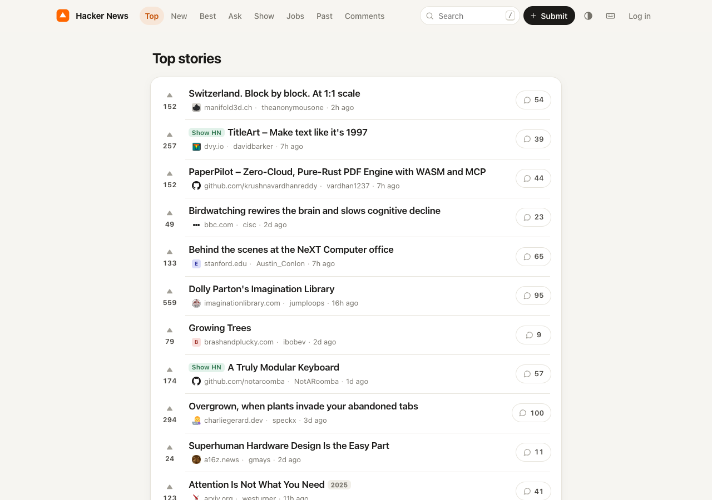
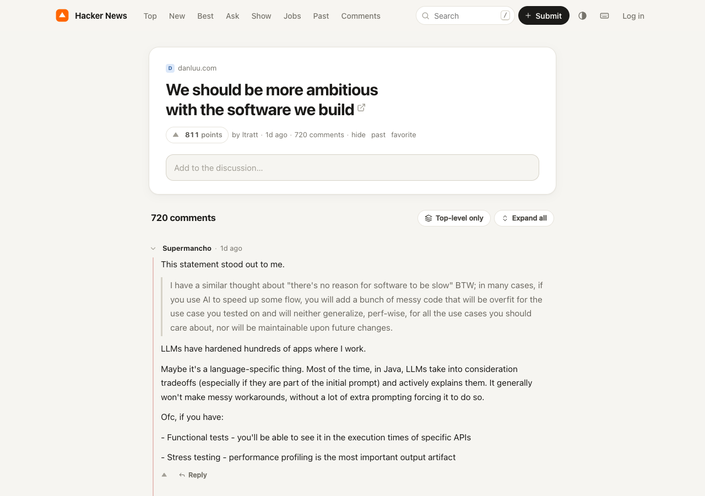
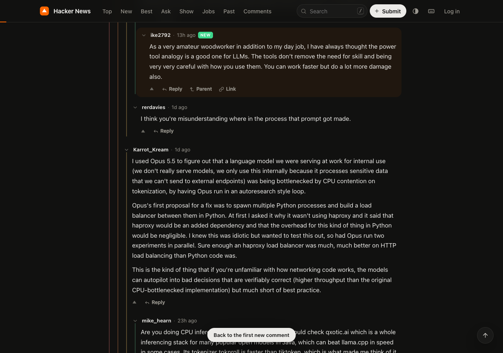
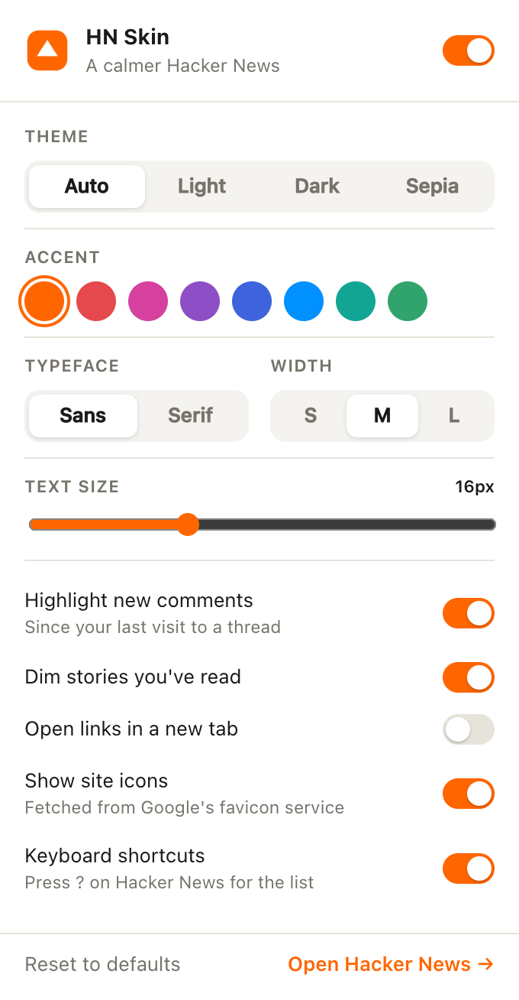

# HN Skin

A Chrome extension that changes the layout of Hacker News. It works on top of the existing site, so voting, replying, hiding, favouriting and logging in still use HN's own pages and endpoints.

Not affiliated with, endorsed by, or connected to Hacker News or Y Combinator.



| Thread | Dark theme |
| --- | --- |
|  |  |

## Features

**Layout**
- Single column with a selectable width (S / M / L)
- Light, dark, sepia, or system theme
- Sans or serif text, 14–20 px, and a choice of accent colour
- Lines starting with `>` render as block quotes; code blocks use a monospace font

**Threads**
- Collapsible comments, by clicking the thread line or the comment header
- Comments added since the last visit to a thread are marked
- Option to show top-level comments only
- Inline reply form
- `OP` and `you` labels

**Story lists**
- Site favicons and labels for Ask / Show / Launch / Tell HN
- Opened stories are dimmed
- Upvote and hide without a page reload

**AI topics (optional)**
- Add an OpenAI, DeepSeek or Claude API key in the popup to label stories on the Best page by topic (AI, Programming, Tech, Science, Security, Business, Politics, Philosophy, History, Culture)
- A row of topic chips above the list filters it; clicking a story's topic label does the same
- Each page is one request with titles and sites only, using a small model by default (`gpt-5-nano`, `deepseek-chat`, `claude-haiku-5-5`; the model can be changed). Labels are cached per story, so revisiting a page makes no request

**Past front pages**
- The Past tab has a date heading, previous/next day arrows, a row of nearby days and a calendar to pick any date back to 2007

**Stats**
- The chart button in the top bar opens `/stats`, a look at the last 30, 15 or 7 days, or the last full day (`?days=`): totals, a daily chart (hourly for one day) of comments, stories and 100-point stories, top stories, the longest threads and most heated debates, top sites and submitters, a heatmap of when popular stories were posted, the most common title words, the best Show HN and Ask HN posts, and a few oddities
- Data comes from the [HN Search API](https://hn.algolia.com/api) (Algolia), fetched one UTC day at a time by the background worker and cached locally

**Keyboard** (press `?` on any page)

| Key | Lists | Comments |
| --- | --- | --- |
| `j` / `k` | next / previous story | next / previous comment |
| `J` / `K` | — | next / previous sibling |
| `o` / `Enter` | open link | `o` opens the story link |
| `c` | open comments | — |
| `x` / `Enter` | — | collapse / expand |
| `p` | — | go to parent |
| `n` | next page | next new comment |
| `[` / `]` | previous / next day (Past) | — |
| `u` | upvote | upvote |
| `r` | — | reply |
| `T` | — | toggle top-level only |
| `/` `t` `?` | search · cycle theme · help | |

Settings are in the toolbar popup.



## Install (unpacked)

1. Clone this repo.
2. Open `chrome://extensions` and enable **Developer mode**.
3. Click **Load unpacked** and select the repo folder.
4. Open [news.ycombinator.com](https://news.ycombinator.com).

It should also work in other Chromium-based browsers.

## How it works

HN serves table-based HTML. The content scripts parse it into plain objects, build a new interface from them, and remove the original layout. Comment HTML is moved over as-is rather than re-parsed. Actions call the same endpoints HN's own `hn.js` uses.

```
manifest.json
src/
  background.js        favicon fetcher (HN's CSP blocks third-party images), AI topic requests, stats data
  shared/settings.js   defaults, load/save, apply prefs to <html>
  content/
    skin.css           all styles, scoped under html.hnx
    early.js           document_start: apply theme, hide original layout
    util.js            DOM helper, icons, time formatting, toast
    store.js           local read history (last visit, highest comment id seen)
    parse.js           HN markup → plain objects
    ui.js              top bar, votes, composer, help overlay
    topics.js          AI topic labels and filter row
    list.js            story lists, past-day navigator
    comments.js        threads, comment lists, inline replies
    stats.js           the /stats page (last 30 / 15 / 7 / 1 days)
    keyboard.js        shortcuts and focus
    main.js            page detection, rendering, fallback
  popup/               settings UI
scripts/make_icons.py  regenerates icons/ (no dependencies)
```

Pages without a custom layout (profiles, submit, login, FAQ) keep HN's markup with the theme applied. If rendering throws an error, the page reloads once without the extension. The extension can also be turned off from the popup.

## Privacy

Read history (which threads were opened and when) is stored in `chrome.storage.local` and never leaves the browser. The only external requests are for site favicons, fetched through DuckDuckGo's icon service (these can be turned off in the popup), and, when the Stats page is opened, public story and comment counts from the HN Search API.

If AI topics are turned on, the API key is kept in `chrome.storage.local` (never synced, not readable by HN's page scripts), and story titles and sites from the Best pages you open are sent to the chosen provider.

## Development

There is no build step. After editing, reload the extension in `chrome://extensions` and refresh HN.

```sh
python3 scripts/make_icons.py   # regenerate icons
zip -r hn-skin.zip manifest.json icons src -x '*.DS_Store'   # package
```

## Disclaimer

Hacker News is a trademark of Y Combinator. This is an independent project; it is not affiliated with or endorsed by Hacker News or Y Combinator.
